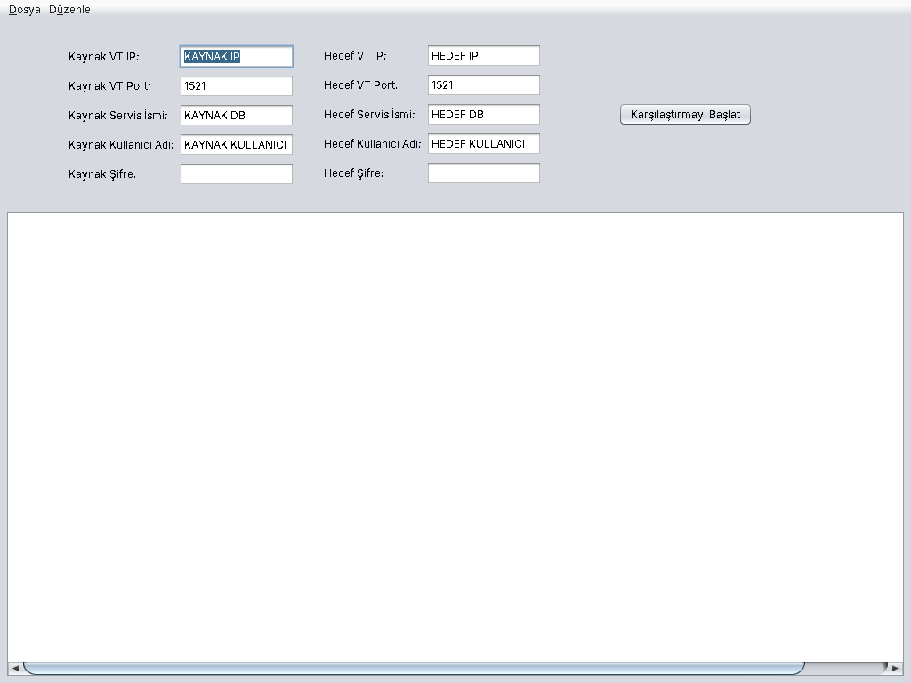

# DBDiff (VT_Fark)

İki Oracle veritabanı şemasını karşılaştırıp **hedef şemayı kaynağa eşitleyecek SQL script'ini** üreten bir Java Swing masaüstü uygulaması.

Kaynak (ör. geliştirme ortamı) ve hedef (ör. canlı ortam) veritabanının bağlantı bilgilerini girersiniz. Uygulama tabloları, sütunları, index'leri, constraint'leri ve view'ları karşılaştırır, eksik ya da farklı olan her şey için `CREATE`, `ALTER` ve `DROP` ifadelerini ekranda listeler. Script'i düzenleyip `.sql` dosyası olarak kaydedebilirsiniz.



## Özellikler

| Nesne | Karşılaştırma | Üretilen ifade |
|---|---|---|
| Tablo | Kaynakta olup hedefte olmayan tablolar | `DBMS_METADATA` ile alınan `CREATE TABLE` |
| Sütun | Veri tipi, uzunluk, hassasiyet/ölçek, varsayılan değer, NULL olabilirlik | `ALTER TABLE ... MODIFY` / `ALTER TABLE ... ADD` |
| Index | Hedefte fazla olan, eksik olan, sütunları (sırasıyla) veya UNIQUE özelliği farklı olan index'ler | `DROP INDEX`, `CREATE [UNIQUE] INDEX` |
| Constraint | Primary key ve check constraint'ler: eksik olanlar ve sütunları farklı olanlar | `ALTER TABLE ... ADD/DROP CONSTRAINT` |
| View | Eksik olan veya metni farklı olan view'lar | `CREATE OR REPLACE VIEW` |

Script'in sonunda geçersiz duruma düşen nesneleri yeniden derlemek için `DBMS_UTILITY.compile_schema` çağrısı yer alır.

## Gereksinimler

- Java 8 veya üzeri (kod Java 8 ile uyumludur)
- Maven 3.x
- Kaynak ve hedef Oracle veritabanlarına ağ erişimi. Bağlanılan kullanıcının `USER_*`, `ALL_*` görünümlerini ve `DBMS_METADATA` paketini okuma yetkisi olmalıdır.

Oracle JDBC sürücüsü (`ojdbc5`) Maven Central'dan otomatik olarak indirilir.

## Derleme ve çalıştırma

```bash
mvn package
java -jar target/VT_Fark-jar-with-dependencies.jar
```

`mvn package` iki jar üretir:

- `target/VT_Fark.jar`: yalnızca uygulama sınıfları
- `target/VT_Fark-jar-with-dependencies.jar`: Oracle sürücüsünü de içeren, tek başına çalıştırılabilen jar

Geliştirme sırasında doğrudan Maven ile de başlatabilirsiniz:

```bash
mvn compile exec:java
```

Proje NetBeans'te Maven projesi olarak açılabilir. Ana pencere `MainFrame.form` dosyası sayesinde NetBeans form editöründe düzenlenebilir.

## Kullanım

1. **Kaynak** ve **Hedef** için IP, port, servis adı (SID), kullanıcı adı ve şifreyi girin.
2. **Karşılaştırmayı Başlat** düğmesine basın. Pencerenin altındaki durum satırı o an hangi nesnenin karşılaştırıldığını gösterir.
3. Üretilen script alt kısımdaki metin alanında listelenir. Düzenlemek isterseniz **Düzenle → Düzenlemeyi Etkinleştir** seçeneğini açın.
4. Script'i **Dosya → Farklı Kaydet** ile ya da metin alanındayken **Ctrl+S** ile `.sql` veya `.txt` olarak kaydedin. Uzantı yazmazsanız `.sql` eklenir.

> **Önemli:** Script'i hedef veritabanında çalıştırmadan önce mutlaka gözden geçirin. Özellikle `DROP INDEX` ve `DROP CONSTRAINT` ifadeleri hedefteki nesneleri siler.

Şema adı, bağlanılan kullanıcı adının büyük harfli halidir. Uygulama bağlantı bilgilerini hiçbir yere kaydetmez.

## Proje yapısı

```
src/main/java/com/github/hasanyildiz/dbdiff/
├── Main.java                  Giriş noktası (Nimbus görünümü + ana pencere)
├── ui/
│   ├── MainFrame.java/.form   Ana pencere (NetBeans GUI Builder)
│   └── CompareWorker.java     Karşılaştırmayı arka planda çalıştıran SwingWorker
├── db/
│   ├── ConnectionSettings.java  Host, port, servis adı, kullanıcı, şifre
│   ├── DatabaseConnection.java  Açık JDBC bağlantısı + şema adı
│   ├── SchemaReader.java        Şema okuma arayüzü
│   └── OracleSchemaReader.java  Oracle veri sözlüğünden okuyan uygulama
├── model/                     DbColumn, DbIndex, DbConstraint, DbView, ConstraintType
├── compare/
│   ├── SchemaComparer.java    Her nesne türü için ortak arayüz
│   ├── TableComparer, ColumnComparer, IndexComparer, ConstraintComparer, ViewComparer
│   ├── ColumnDiff.java        İki sütun tanımı arasındaki farklar
│   └── SchemaDiff.java        Karşılaştırıcıları sırayla çalıştırıp script'i üretir
└── sql/
    └── DdlBuilder.java        DDL ifadelerinin metnini üretir
```

### Mimari

- **Okuma, karşılaştırma ve SQL üretimi ayrıdır.** `OracleSchemaReader` veritabanını okur, `*Comparer` sınıfları farkları bulur, `DdlBuilder` ifadeleri yazar.
- **Karşılaştırıcılar veritabanına değil, `SchemaReader` arayüzüne bağlıdır.** Bu sayede testlerde gerçek bir veritabanı yerine bellekteki sahte bir şema kullanılır.
- **Arayüz donmaz.** Uzun süren karşılaştırma `SwingWorker` içinde çalışır, ekran güncellemeleri Swing olay iş parçacığında (EDT) yapılır.

### Yeni bir karşılaştırma eklemek

1. Gerekirse `SchemaReader` arayüzüne ve `OracleSchemaReader` sınıfına yeni bir okuma metodu ekleyin.
2. `SchemaComparer` arayüzünü uygulayan yeni bir sınıf yazın. Üretilen satırları `DiffListener.onScriptLine` ile, durum mesajlarını `onProgress` ile bildirin.
3. Sınıfı `SchemaDiff` kurucusundaki listeye ekleyin.

Yeni bir constraint tipini (ör. unique) desteklemek için `ConstraintType` enum'una bir değer eklemeniz yeterlidir.

## Testler

```bash
mvn test
```

Karşılaştırma mantığı `src/test/java` altındaki JUnit 4 testleriyle, veritabanı gerektirmeden doğrulanır (`FakeSchemaReader`).

## Bilinen sınırlamalar

- Foreign key ve unique constraint'ler karşılaştırılmaz.
- Hedefte olup kaynakta olmayan tablo ve sütunlar için `DROP` üretilmez.
- Check constraint'lerde yalnızca sütunlar karşılaştırılır, koşul metni karşılaştırılmaz.
- Sistem tarafından adlandırılan nesneler (`SYS_C...` gibi) iki veritabanında farklı adlar taşıdığı için eksik görünebilir.
- Sequence, trigger, procedure, function ve package gibi nesneler karşılaştırılmaz.
- Bağlantı adresi SID biçimindedir (`jdbc:oracle:thin:@host:port:SID`).
